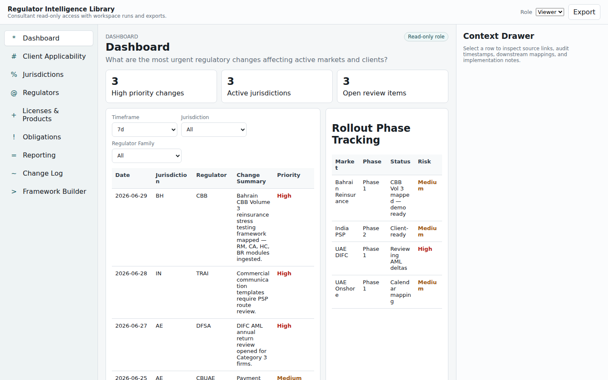

# Regulator Intelligence Library

**Status:** v2 (multi-jurisdiction build), working prototype · Independent open-source project

**Documentation:** [LICENSE](./LICENSE)

Maintained by **Gururaj G J** — Senior Fraud Risk | Merchant Risk | Financial Crime Professional
[LinkedIn](https://www.linkedin.com/in/gururaj-gj-52a062b4/) · [GitHub](https://github.com/Gururaj-GJ-G)

---

## What it is

A regulatory database and client-applicability matrix covering multiple jurisdictions, with a
built-in **Framework Generator**: given a client's profile, it produces a 7-section framework
document with up to 28 stress scenarios across 7 risk domains, exportable to CSV. Includes a
seed pack for a Middle East jurisdiction's central bank rulebook (obligations, licenses, and
configuration presets) alongside an India payment-services regulatory flow (RBI / FIU / DPB /
TRAI).

## Screenshot

## Why this exists

Mapping a client's specific regulatory exposure across multiple frameworks is normally a manual,
error-prone exercise repeated from scratch for every engagement. This library structures that
mapping once, as reusable, queryable data, so a client-applicability assessment becomes a
data-driven output rather than a fresh spreadsheet each time.

## Architecture

A dependency-free HTML/JS/CSS front end running entirely client-side against structured seed
data, with a PostgreSQL schema already designed for a future live backend — the prototype
currently runs on seed data while the schema is ready for that transition.

## Known limitation (flagged honestly)

Regulatory data maintenance is the harder problem than the software itself: whether entries are
manually curated, ingested from regulator RSS feeds, or crowdsourced determines whether this
becomes a durable, current product or a snapshot that goes stale. That maintenance model is not
yet finalized.

## Use cases

Compliance and risk consulting engagements that need a structured, jurisdiction-aware starting
point for client regulatory-applicability assessments.

## License

MIT — see [LICENSE](./LICENSE).
